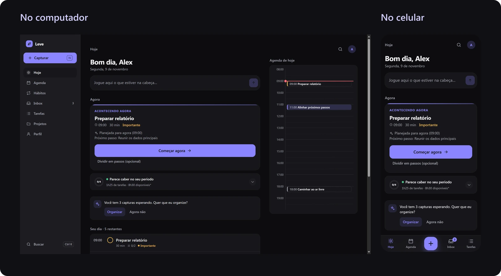
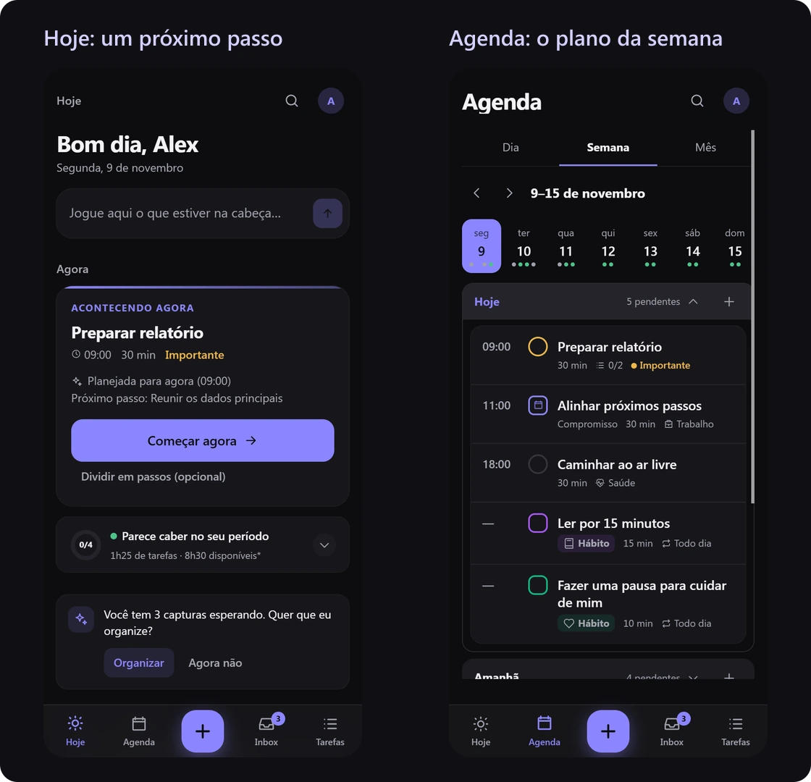
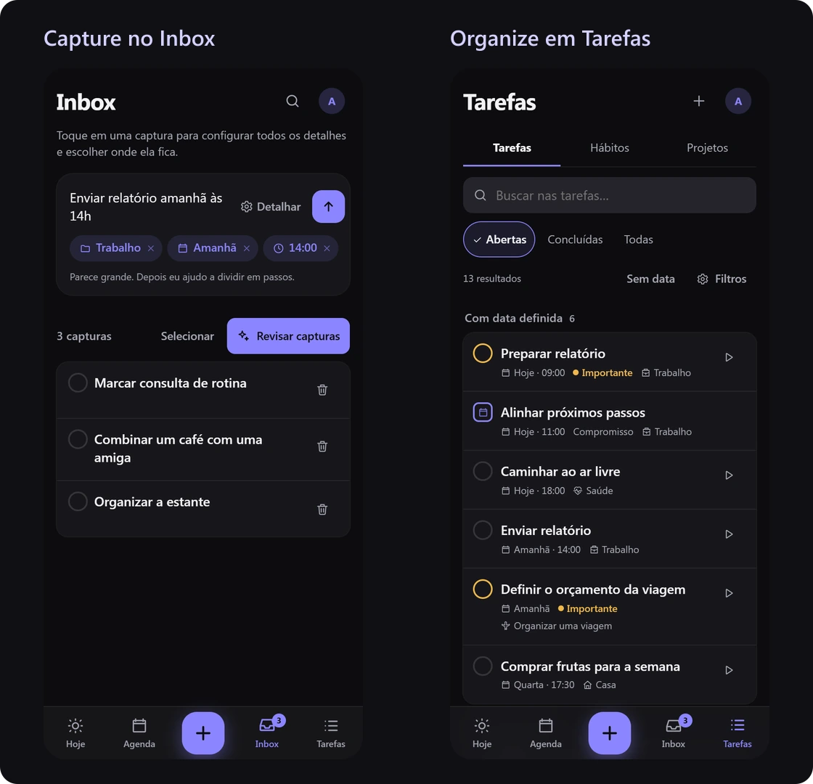
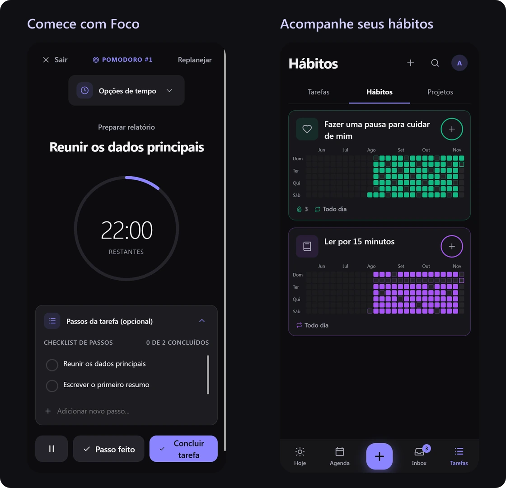

# Leve

**Destrave sua vida, um próximo passo de cada vez.**

Tire tudo da cabeça. Organize o que importa e encontre um próximo passo possível para o seu dia.

O Leve é um app de organização pessoal para quem concilia tarefas, compromissos, hábitos e projetos e precisa de clareza para começar. Ele conecta suas pendências a um plano para o dia e acompanha a execução, com espaço para ajustar a rota quando a rotina muda.

[**Experimentar o Leve**](https://leve-flame.vercel.app) · [**Explorar o código**](https://github.com/LucasFigs/leve)

*Projeto pessoal em desenvolvimento. A versão hospedada e os serviços opcionais ainda exigem validação contínua; não há garantia de homologação completa para todos os dispositivos.*

## Conheça o Leve

Pensado para o uso cotidiano no celular, o Leve é uma aplicação web responsiva: pode ser instalado como PWA em navegadores compatíveis ou acessado pelo computador.



As imagens mostram o aplicativo real com uma rotina e um histórico inteiramente fictícios.

## Da pendência à ação

**Capturar → Organizar → Planejar → Começar → Ajustar.**

1. **Capturar:** registre o que está na cabeça sem precisar decidir tudo naquele momento.
2. **Organizar:** escolha prioridades, categorias e projetos para dar um lugar às pendências.
3. **Planejar:** distribua atividades considerando horários, duração estimada e disponibilidade configurada.
4. **Começar:** veja uma próxima ação, entenda a recomendação e entre em modo Foco.
5. **Ajustar:** reagende ou reorganize o plano quando o dia tomar outro rumo.



## Funcionalidades que fazem diferença

### Menos esforço para registrar e encontrar

Escreva uma frase como **“Enviar relatório amanhã às 14h”**. A captura reconhece informações em português e mostra sugestões de dia e horário que você pode revisar. O Inbox guarda o que ainda precisa ser organizado; prioridades, categorias, busca e filtros ajudam a encontrar tarefas abertas, planejadas e concluídas.



### Um plano que considera o seu tempo

A tela **Hoje** reúne a próxima ação e o resumo do dia. O planejamento considera as durações estimadas e os períodos disponíveis; a **Agenda**, em dia, semana ou mês, ajuda a enxergar a distribuição das atividades.

As estimativas usam **os itens registrados no Leve e a disponibilidade configurada**. Compromissos externos não são importados. Se os planos mudarem, você pode reagendar tarefas e escolher o alcance das alterações em atividades recorrentes: uma ocorrência, as seguintes ou a série inteira.

### Continuidade para o que importa

No **modo Foco**, acompanhe a tarefa e seus passos, com Pomodoro opcional. Em **Hábitos**, registre realizações e visualize o histórico ao longo dos dias, com cores e ícones personalizáveis. Em **Projetos**, reúna as atividades de um objetivo, como organizar uma viagem, e acompanhe as pendências e o progresso das tarefas pontuais.



## Um exemplo no dia a dia

Imagine precisar entregar um relatório, marcar uma consulta, organizar uma viagem e manter um hábito de leitura. Você pode guardar a consulta no Inbox, reunir as etapas da viagem em um projeto e planejar um período para o relatório. Na hora de agir, o próximo passo pode ser apenas **reunir os dados principais**. Se surgir um imprevisto, ajuste o plano e continue de onde for possível.

O propósito é diminuir a sobrecarga da organização e ajudar a transformar intenção em ação.

## No celular e no computador

O Leve funciona no navegador e pode ser instalado como PWA, conforme o suporte do aparelho. Após carregar os arquivos necessários, o armazenamento local permite reabrir e trabalhar offline, sujeito à disponibilidade e ao espaço do navegador. Preserve uma cópia de recuperação quando houver aviso de falha; limpar os dados do site pode apagar registros locais.

A **sincronização entre dispositivos** é opcional e depende de conta, Supabase configurado e conexão para confirmar os envios. **Lembretes push** também exigem infraestrutura configurada, permissão e suporte do navegador/dispositivo. A entrega de notificações e a recuperação de sessão precisam ser validadas no ambiente utilizado.

## Para desenvolver

### Tecnologias e organização

React 18, TypeScript e Vite compõem a interface. As regras de captura, planejamento, recorrência e recomendação ficam em módulos de domínio executados no navegador. O assistente usa **regras e heurísticas locais**, sem API de IA generativa.

O app utiliza persistência local, PWA e, quando configurado, Supabase Auth, Postgres com RLS e Realtime. A validação inclui Vitest, testes SQL em PostgreSQL isolado e GitHub Actions. Consulte a [arquitetura](docs/arquitetura.md) para conhecer os módulos e os limites da sincronização.

### Executar localmente

Use **Node.js 22.12 ou superior** e npm. O campo `engines` também aceita a linha 20 a partir de 20.19.

```bash
git clone https://github.com/LucasFigs/leve.git
cd leve
npm ci
npm run dev
```

Abra o endereço informado pelo Vite. **Sem configurar Supabase, o app funciona localmente e salva no navegador, sem credenciais.** Esse modo não inclui sincronização entre dispositivos nem push de servidor. O servidor de desenvolvimento escuta apenas no computador local; para teste intencional na rede doméstica, use `npm run dev -- --host 0.0.0.0` e encerre-o ao terminar.

### Verificações locais

```bash
npm test
npm run build
npm audit
npm run check:secrets -- --dist --history
```

`npm run preview` abre a prévia local do build. Para verificações sem carregar `.env*`, defina `LEVE_ISOLATED_CHECKS=1` antes de testar ou compilar; o build isolado não deve substituir o build configurado de produção. No PowerShell, use `$env:LEVE_ISOLATED_CHECKS='1'`; se necessário, chame `npm.cmd`.

Com PowerShell e Docker disponíveis, `npm run test:database` executa as verificações em PostgreSQL 16 descartável. Elas cobrem políticas, validações e quotas, mas não substituem testes reais de Auth, Realtime, cron ou entrega de push. `npm run setup:push -- --bundle` gera apenas o pacote local do worker, sem publicar.

### Configuração opcional e segurança

Para um ambiente próprio com serviços externos, use `.env.example` como referência e preencha somente o necessário em `.env.local`, que não deve ser versionado. As variáveis públicas de frontend são `VITE_SUPABASE_URL`, `VITE_SUPABASE_ANON_KEY` e, para push, `VITE_VAPID_PUBLIC_KEY`. `VITE_GOOGLE_CLIENT_ID` permanece como campo legado; não habilita Calendar nesta versão.

**Variáveis `VITE_*` entram no bundle.** Tokens administrativos, client secrets, chave privada VAPID e segredo do cron pertencem ao servidor/scripts. Não importe o `.env.local` inteiro para a Vercel. Chaves públicas não substituem autorização no banco.

Os scripts `setup:supabase`, `setup:push` e `setup:google -- --apply` alteram serviços remotos; **não são parte da execução local comum**. Não reaplique configurações em um ambiente existente sem revisar destino, efeitos e backup. O deploy Vercel não aplica SQL nem publica funções Supabase.

Para configurar e validar infraestrutura, consulte o [guia de publicação](docs/publicacao.md), os [controles e limites de segurança](docs/seguranca.md) e o [checklist de validação](docs/checklist-publicacao.md). A antiga integração Google Agenda está em encerramento; o [plano técnico de transição](docs/google-agenda.md) preserva o login Google de identidade e detalha a ativação do backend e os cuidados com clientes antigos.

Testes e verificações de dependências não garantem ausência de vulnerabilidades. Confirme os controles e as versões efetivamente publicados antes de disponibilizar uma instância a outras pessoas.

### Contribuir e acompanhar

- [Como contribuir e validar mudanças](CONTRIBUTING.md)
- [Relatar uma vulnerabilidade de forma privada](SECURITY.md)
- [Arquitetura e responsabilidades dos módulos](docs/arquitetura.md)
- [Jornada essencial do produto](docs/jornada-essencial.md)
- [Melhorias de experiência](docs/melhorias-experiencia.md)
- [Auditoria de integridade e confiabilidade](docs/auditoria-evolucao.md)

O Leve segue em evolução, com o objetivo de tornar mais simples encontrar e dar o próximo passo.
