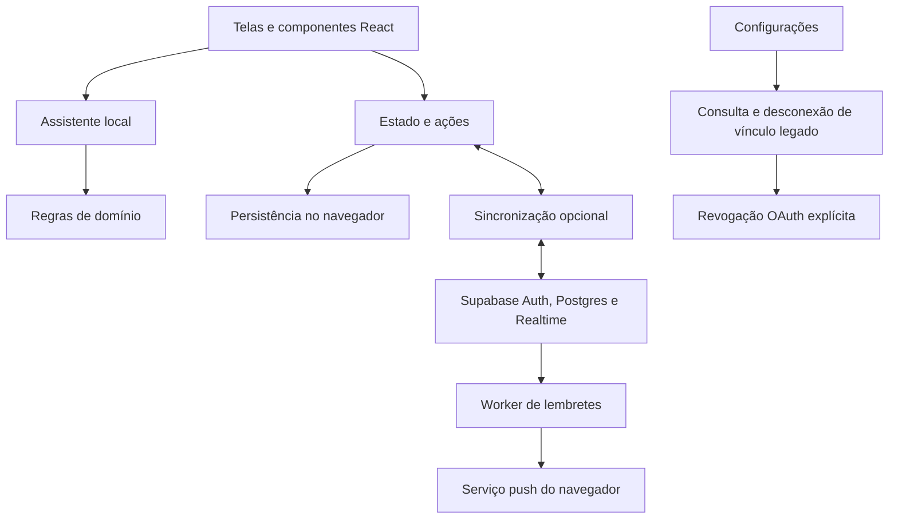

# Arquitetura

O Leve é uma SPA em React e TypeScript, empacotada pelo Vite. A interface coordena módulos de domínio que rodam no navegador. O assistente atual usa regras e heurísticas locais; não depende de um modelo generativo nem de uma API de IA.

| Diretório | Responsabilidade |
| --- | --- |
| `src/domain` | Interpretação de texto, datas, recorrências, priorização, planejamento e validação |
| `src/services` | Assistente local, Google Agenda e notificações |
| `src/store` | Estado, ações, persistência e sincronização por entidade |
| `src/screens` | Telas do produto |
| `src/components` e `src/sheets` | Componentes reutilizáveis e painéis de edição |
| `supabase` | Schema, políticas de acesso, worker e testes SQL |
| `scripts` | Preparação de infraestrutura, verificações e geração de artefatos |

A persistência local permite uso sem backend configurado. Estado e diário de alterações são gravados sem debounce; conflitos entre abas e dados inválidos pausam gravação/sincronização e oferecem exportação para recuperação, preservando o snapshot original. Com Supabase, o cliente sincroniza entidades e recebe atualizações por Realtime. As políticas RLS do banco fazem a autorização; os filtros do cliente são uma camada adicional. Não há transação atômica entre as chaves locais nem fusão automática de versões conflitantes.

O Calendar está em encerramento: sem observador do store, refresh, envio ou exclusão de eventos. Restam consulta autenticada e desconexão. IDs legados e outbox são preservados; a fila não participa das pendências Supabase. Ao sair/trocar conta, é preservada em arquivo local inerte por proprietário, recuperado apenas na conta original. O login Google continua com escopos de identidade. Ver [plano operacional](google-agenda.md).

O worker reutiliza as regras de lembretes do domínio. `source.ts` é o código editável; `index.ts` é o pacote gerado para publicação. Os testes SQL usam um PostgreSQL isolado com papéis e `auth.uid()` de teste, sem substituir a validação dos serviços reais do Supabase.
